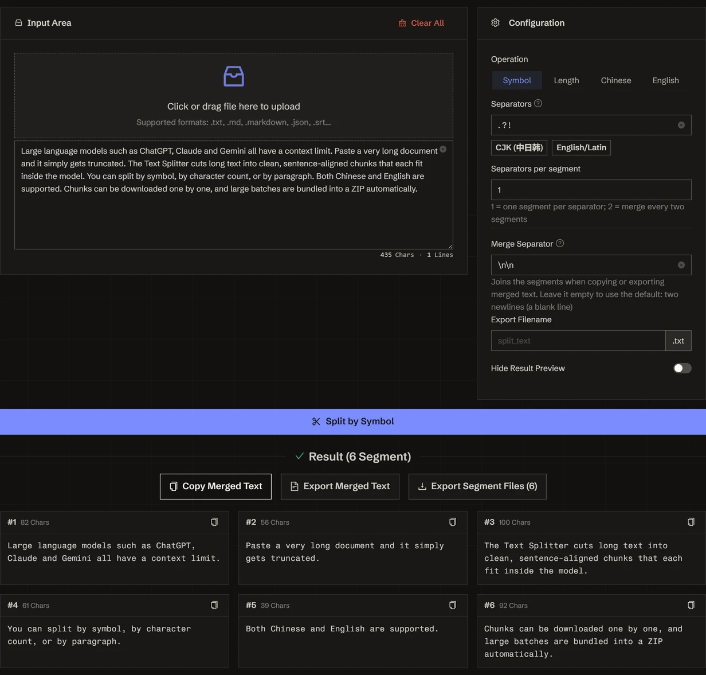

<h1 align="center">
✂️ Text Splitter
</h1>

    <em>Split overlong text by length or by Chinese/English sentence boundaries, to feed models with a character cap</em>

    <b>English</b> · <a href="./README.zh.md">简体中文</a>

  
  

**Text Splitter** cuts one overlong piece of text into chunks you can feed in one at a time — useful for ChatGPT, DeepSeek, Claude and other models with a per-message character cap, and equally for splitting documents or long social posts. Four modes — by symbol, by length, Chinese paragraph, English paragraph — with delimiter-aware cut points (escapes like `\n` and `\t` supported); download the chunks one by one or as a ZIP. Everything runs entirely in your browser — no servers, no uploads.

👉 **Try it online**: <https://tools.newzone.top/en/text-splitter>

## Key Features

- **Four Splitting Modes**: By Symbol, By Length, Chinese Paragraph, and English Paragraph, switched with a Segmented control that only shows the active mode's settings
- **Delimiter-Aware Boundaries**: in By Length mode the optional alignment-delimiter field snaps cuts to sentence boundaries so text isn't cut mid-sentence; in By Symbol mode the delimiter field itself decides where to cut
- **Quick Delimiter Presets**: One-click "CJK (Chinese/Japanese/Korean)" (`。 ？ ！`) and "English/Latin" (`. ? !`) buttons
- **Escape Character Support**: `\n` (newline), `\r` (carriage return), `\t` (tab), `\s` (space), `\\` (backslash)
- **Batch Export**: ≤ 3 segments download individually; > 3 are automatically packaged as a ZIP
- **Merged Export**: Combine all segments into one file separated by double newlines
- **Quick Copy**: One-click copy of any segment, with a checkmark confirmation
- **Performance Friendly**: Preview auto-hides above 500 segments to keep the page responsive (export still works)
- **Fully Local**: Runs entirely in your browser, so even million-character files stay private

## How to Use

1. Paste or upload your long text (drag in a text file).
2. Pick a **mode**:
   - Split at delimiters (the default) → **By Symbol**
- Fixed-size chunks (for AI input) → **By Length**
   - Long Chinese text by paragraph → **Chinese Paragraph**
   - English text by sentence → **English Paragraph**
3. To align cuts to delimiters (`. ? !` etc.), fill in the alignment-delimiter field in By Length mode; in By Symbol mode the delimiter field decides the cut points.
4. Click **Split by symbol** (the button label follows the selected mode) — segments download as individual files (≤ 3) or a ZIP bundle (> 3).

## Four Splitting Modes

Modes are picked via the Segmented control at the top of the Configuration card. Each mode shows only its own settings, so the panel stays focused.

### 1. By Symbol

Splits on delimiters alone — every Nth delimiter starts a new segment (default 1 = one segment per separator, 2 = merge every two). The **delimiter** field is pre-filled per locale (`。 ？ ！` for Chinese, `. ? !` for Latin) and accepts:

- Manual entry, e.g. `。 ？ ！` (separate multiple delimiters with a space)
- Click **CJK** to fill `。 ？ ！`
- Click **Latin** to fill `. ? !`
- Escape sequences: `\n`, `\r`, `\t`, `\s`, `\\`

Delimiter splits keep the delimiter at the end of each segment.

### 2. By Length

Chunks text into blocks of a given character count (default 5000 — the per-request cap of the free Google Translate / DeepL tiers, and a comfortable size for LLM context windows). The optional **alignment delimiter** field snaps chunk boundaries to the nearest delimiter so sentences aren't cut mid-way; leave it empty and the text is hard-chunked by length. The character count can never be 0 — it falls back to the default.

### 3. Chinese Paragraph

Detects Chinese paragraph boundaries using punctuation and line-break rules; paragraph interiors are preserved. Designed for Chinese articles, blog posts, and other content where paragraph integrity matters.

### 4. English Paragraph

Uses the browser's built-in Intl.Segmenter sentence segmentation to detect paragraph boundaries. Good for documents, emails, and papers.

## Shared Settings

All modes share these:

- **Hide Results**: when there are many segments (auto-triggers above 500), enable this to hide the preview and keep the page responsive. Export still works regardless of visibility.
- **Export Filename**: base name for exported files. Defaults to the uploaded file's name, or `split_text` if nothing was uploaded. A `.txt` suffix is added unless you type another.

## Export and Copy Functions

- **Export Merged Text**: combine all segments into a single file, separated by double newlines.
- **Batch Export**: ≤ 3 segments download individually; > 3 are bundled into a single `<filename>_split_files.zip` automatically.
- **Per-Segment Copy**: each segment card has a copy button; the icon flips to a checkmark on success.

## Common Patterns

- **LLM Context Prep**: length 2000–4000 with the alignment delimiter `。 ？ ！` or `. ? !` — boundaries auto-snap to sentence ends
- **Sentence-Level Split**: use **By Symbol** mode with delimiters `。 ？ ！` (or `. ? !`) — one split at each delimiter
- **Paragraph-Level Split**: use Chinese Paragraph or English Paragraph mode
- **Code / Markdown Split**: By Length mode with the alignment delimiter `\n\n` (literal `\n` supported)

## FAQ

**What's the difference between the four splitting modes?** "By Symbol" cuts at delimiters alone; "By Length" cuts into fixed-size blocks (default 5000) and optionally snaps the boundaries to a delimiter; "Chinese Paragraph" / "English Paragraph" run language-aware sentence detection — Chinese uses punctuation rules, English uses the browser's built-in Intl.Segmenter. Pick whichever matches your input language.

**Do the two delimiter fields do the same thing?** No — each mode has its own field and they are independent. **By Symbol** uses the *delimiter* to decide where to cut (every Nth one). **By Length** uses the optional *alignment delimiter* only to snap the boundaries of a length-based chunk; leave it empty and the text is hard-chunked.

**When does batch export package as ZIP?** Above 3 segments. ≤ 3 segments download as individual files; > 3 are bundled into a single `<filename>_split_files.zip` to avoid spamming your downloads folder.

**Why does the preview hide automatically sometimes?** When the result exceeds 500 segments, the preview is auto-hidden to keep the page responsive. Click "Show Anyway" to render it, or just use the export buttons (which work regardless of visibility). You can also force-hide via the "Hide results" toggle in the config.

**Is anything uploaded?** No. The tool runs entirely in your browser — no servers, no uploads. Process even million-character files without bandwidth concerns.

## Documentation & Deployment

For detailed usage instructions and deployment guides, see the **[Official Documentation](https://docs.newzone.top/en/guide/text/text-splitter.html)**.

## Contributing

Contributions are welcome! Feel free to open issues and pull requests.
