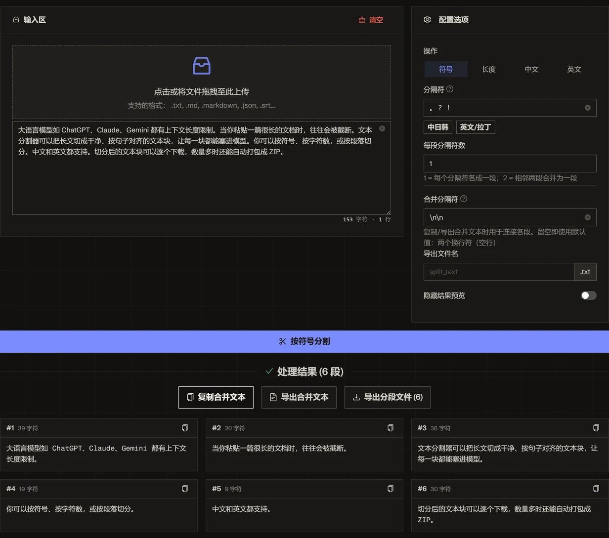

<h1 align="center">
✂️ 文本分割器
</h1>

    <em>把超长文本按长度或中英文语义切成多段，喂给有字数上限的 AI 模型</em>

    <a href="./README.md">English</a> · <b>简体中文</b>

  
  

**文本分割器** 把一段超长文本切成能逐段投喂的小块，适合 ChatGPT、DeepSeek、Claude 这类有单次字数上限的模型，也适合拆文档、拆社媒长文。四种分割模式——按符号切分、按长度切分、中文分段、英文分段，可用分隔符对齐切点（支持 `\n` `\t` 等转义），切完逐个下载或一键打包 ZIP。工具完全在浏览器本地运行，无服务器、无上传。

👉 **在线体验**：<https://tools.newzone.top/zh/text-splitter>

## 核心特性

- **三种分割模式**：按长度切分、中文分段、英文分段，通过 Segmented 选择器切换，每种模式只显示自身相关配置
- **分隔符对齐切点**：分隔符输入框始终显示（无需开关），让按长度切分的切点对齐到句子边界，避免句子被截断
- **快捷分隔符预设**：一键填充「中日韩」（`。 ？ ！`）和「英文/拉丁」（`. ? !`）
- **转义字符支持**：`\n`（换行）、`\r`（回车）、`\t`（制表符）、`\s`（空格）、`\\`（反斜杠）
- **批量导出**：≤ 3 段逐个下载，> 3 段自动打包为 ZIP 文件
- **合并导出**：所有片段合并为单文件，段落间以双换行分隔
- **快速复制**：单击即可复制任意片段，并有打勾确认
- **性能友好**：结果超过 500 段时自动隐藏预览，保持页面流畅（导出不受影响）
- **完全本地**：完全在浏览器本地运行，百万字级文件也能放心处理

## 如何使用

1. 粘贴或上传长文本（可拖入文本文件）。
2. 选 **切分模式**：
   - 按分隔符切（默认）→ **按符号切分**
   - 切成固定字符块（喂给 AI）→ **按长度切分**
   - 中文长文按段 → **中文分段**
   - 英文按句 → **英文分段**
3. 想让切点对齐到 `. ? !` 等标点，在分隔符栏填上。
4. 点 **处理** → 片段逐个下载（≤ 3 段）或打包成 ZIP（> 3 段）。

## 四种分割模式

四种模式通过配置卡片顶部的 Segmented 选择器切换，每种模式只会显示相关的配置项，配置互不干扰。

### 1. 按符号切分

只按分隔符切：每累计 N 个分隔符切一刀（默认 1，即每个分隔符切一段；填 2 就是每两个分隔符合成一段）。**分隔符**输入框按语种预填，支持：

- 手动输入，如 `。 ？ ！`（多个符号用空格分隔）
- 点击 **中日韩** 一键填充 `。 ？ ！`
- 点击 **英文/拉丁** 一键填充 `. ? !`
- 转义字符：`\n`、`\r`、`\t`、`\s`、`\\`

分隔符切分会把符号保留在每段末尾。

### 2. 按长度切分

按设定的字符数把文本切成块（默认 5000 字符 —— 免费版 Google Translate / DeepL 的单次上限，也是 LLM 上下文里比较稳的块大小）。**对齐符**输入框是可选的：填了就把切点对齐到最邻近的对齐符，避免句子被截断；留空就是硬按长度切，不管句子边界。字符数不能为 0 —— 填 0 会回落到默认值。

### 3. 中文分段

按中文段落规则切分：根据中文标点和换行符智能识别段落边界，不改变段落内的换行。专为中文文章、博客内容等需要保持段落完整性的文本设计。

### 4. 英文分段

使用浏览器内建的 Intl.Segmenter 分句识别段落边界。适合英文文档、邮件、论文的段落化切分。

## 通用设置

所有模式共享以下两项设置：

- **隐藏结果**：切分结果过多（默认 >500 段时自动触发）可开启本项隐藏预览，避免页面卡顿。此时仍可正常导出。
- **导出文件名**：自定义导出文件的基础名。默认用上传文件名，未上传则用 `split_text`。后缀默认为 `.txt`，也可手动填写其他后缀。

## 导出和复制功能

- **导出合并文本**：所有片段合并为单文件，段落间用双换行分隔。
- **批量导出**：段落数 ≤ 3 时逐个下载，> 3 时自动打包为单个 `<文件名>_split_files.zip`，避免一次下载过多文件。
- **单段复制**：每段卡片上的复制按钮，点击后按钮图标变为打勾确认。

## 常见用法

- **LLM 输入切分**：按长度 2000–4000，**对齐符**填 `。 ？ ！` 或 `. ? !`，切点自动对齐到句末
- **按句切分**：用**按符号切分**模式，分隔符填 `。 ？ ！`（或英文结束符），按任意一个分隔符就切一次
- **按段落切分**：选中文分段或英文分段模式
- **代码/Markdown 切分**：按长度模式 + 转义字符 `\n\n` 作为对齐符

## 常见问题

**四种切分模式有什么区别？** 「按符号切分」只按分隔符切；「按长度切分」按固定字符数切块（默认 5000），可选地把切点对齐到分隔符；「中文分段」/「英文分段」做语言感知的句子检测——中文按标点规则，英文用浏览器内建的 Intl.Segmenter。按输入语言选模式即可。

**两个分隔符字段是一回事吗？** 不是——每个模式各管各的，互不干扰。**按符号切分**用*分隔符*决定在哪切（每 N 个切一次）；**按长度切分**的*对齐符*只用来把长度块的切点对齐到最近的分隔符，留空就是硬切。

**批量导出什么时候打包成 ZIP？** 超过 3 段时打包。≤ 3 段逐个下载；> 3 段自动打成 `<文件名>_split_files.zip`，避免下载文件夹里塞满文件。

**为什么有时候预览被自动隐藏？** 结果超过 500 段时自动隐藏预览以保持页面流畅。可以点「仍要显示」强制显示，或者直接用导出按钮（导出不受影响）。也可以手动开「隐藏结果预览」开关。

**数据会上传吗？** 不会。工具完全在浏览器本地运行，无服务器、无上传。可放心处理百万字级文件。

## 文档与部署

详细使用说明和部署指南，请参阅 **[官方文档](https://docs.newzone.top/guide/text/text-splitter.html)**。

## 参与贡献

欢迎通过 Issue 或 Pull Request 参与贡献！
